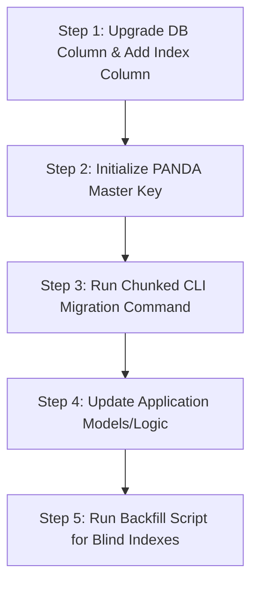

# PANDA PHP SDK

**PANDA (Private And Secure Data Access)** — AES-256-GCM field-level encryption SDK for PHP applications.

## Requirements

- PHP ≥ 8.1 with `ext-openssl`
- Composer

## Installation

Install the package via Composer:

```bash
composer require jatimprovcsirt/panda-php
```

---

## 1. PANDA Master Key Initialization (Langkah Pertama yang Wajib)

Sebelum menulis kode integrasi apapun, Anda harus menghasilkan kunci master lokal untuk aplikasi Anda. Ini adalah gerbang keamanan satu kali sebelum PANDA bisa beroperasi.

### Langkah 1: Dapatkan PANDA Access Token

Anda harus memiliki PANDA Access Token untuk menginisialisasi kunci master aplikasi Anda.

**Daftar aplikasi dan dapatkan token di:** https://csirt.jatimprov.go.id/panda

> [!NOTE]
> Setiap aplikasi memerlukan token unik. Token digunakan sebagai gerbang keamanan satu kali untuk inisialisasi kunci.

### Langkah 2: Jalankan Perintah Init

Jalankan perintah berikut di direktori root proyek Anda. Ganti `YOUR_TOKEN` dengan PANDA Access Token yang diperoleh dari portal (panjang: 48 atau 64 karakter hex):

```bash
# Menggunakan binary CLI dari vendor (setelah composer install)
php vendor/bin/panda init --token YOUR_TOKEN
```

Setelah menjalankan perintah ini, wizard akan:
1. Memvalidasi token Anda
2. Meminta Anda memasukkan Key Identifier (KID) untuk kunci pertama
3. Menghasilkan kunci 256-bit yang aman secara kriptografis secara **lokal**
4. Menambahkan kunci dalam format base64 ke file `.env` Anda (misal: `PANDA_KEY_OPD_DUKCAPIL_KEY_1=...`)

> [!NOTE]
> Untuk pengembangan lokal, Anda dapat menggunakan demo token bawaan:
> `panda_demo_76d08573d453cdbdb4bf5704d13f8f54d57cd3c47c9b4be2`

### Langkah 2: Apa yang Terjadi?

Perintah `init` melakukan hal berikut:
1. Memvalidasi format token Anda.
2. Menghasilkan kunci 256-bit yang aman secara kriptografis secara **lokal** (token tidak pernah menerima kunci ini).
3. Secara otomatis menambahkan kunci dalam format base64 ke file `.env` Anda (misal: `PANDA_KEY_OPD_DUKCAPIL_KEY_1=...`).

### Langkah 3: Restart Server/Terminal (Penting!)

> [!IMPORTANT]
> Karena PHP membaca variabel environment dari `.env` saat startup:
> - **Jika menjalankan web server** (misal `php artisan serve`, Apache, Nginx, Docker, php-fpm), Anda **HARUS merestart server/container** agar variabel environment baru terbaca.
> - **Jika menjalankan perintah di terminal/CMD**, Anda **HARUS membuka terminal baru** atau reload variabel environment.

### Menambahkan KID/Kunci Tambahan

Jika aplikasi Anda membutuhkan lebih dari satu kunci (misalnya untuk bidang data yang berbeda atau rotasi secara bertahap), gunakan perintah `generate` untuk menambahkan kunci tambahan tanpa memerlukan token:

```bash
# Kunci kedua: untuk field nomor HP
php vendor/bin/panda generate opd-dukcapil-key-2

# Kunci untuk blind index (suffix -idx wajib dipisah dari kunci enkripsi)
php vendor/bin/panda generate opd-dukcapil-key-1-idx
```

> [!NOTE]
> Perintah `generate` hanya dapat digunakan setelah inisialisasi awal dengan `init`. Tidak perlu token lagi untuk menambahkan kunci baru. Setelah kunci tersimpan di `.env`, operasi enkripsi/dekripsi sehari-hari **tidak pernah** menghubungi portal lagi.

### Rotasi Kunci (Tanpa Portal)

Untuk merotasi kunci pada KID yang sudah ada, gunakan `rotate-key`. Perintah ini berjalan **sepenuhnya lokal** tanpa memerlukan token:

```bash
# Rotasi: buat kunci baru dan set sebagai default KID aktif
php vendor/bin/panda rotate-key --new-kid opd-dukcapil-key-2
```

### Menghapus Kunci (Crypto-Shred)

```bash
# Hapus kunci secara permanen
# PERINGATAN: Data yang dienkripsi dengan kunci ini tidak bisa didekripsi lagi!
php vendor/bin/panda shred opd-dukcapil-key-old
```

### Referensi CLI

#### Mode Non-Interaktif (Flags untuk CI/CD)

Semua perintah CLI dapat digunakan dalam mode non-interaktif dengan menggunakan flag. Ini sangat berguna untuk:

- **CI/CD pipelines** - Otomatisasi tanpa interaksi pengguna
- **Docker containers** - Inisialisasi otomatis saat container start
- **Infrastructure as Code** - Integrasi dengan Terraform, Ansible, dll
- **Automated testing** - Setup dan teardown otomatis

##### Perintah Init - Mode Non-Interaktif

```bash
# Quick init dengan Local provider (mode tercepat)
php vendor/bin/panda init --quick --token <token> --kid default-key

# Init tanpa generate kunci pertama (untuk automation lanjutan)
php vendor/bin/panda init --quick --token <token> --skip-key-gen

# Reinitialize paksa (overwrite konfigurasi yang sudah ada)
php vendor/bin/panda init --quick --token <token> --reinit
```

**Flag `init` yang tersedia:**

| Flag | Short | Default | Deskripsi |
|------|-------|---------|-----------|
| `--token <value>` | `-t` | - | PANDA access token (atau set `PANDA_ACCESS_TOKEN` env) |
| `--kid <value>` | `-k` | `default-key` | Key Identifier untuk kunci pertama |
| `--quick` | `-q` | `false` | Skip wizard, gunakan quick setup dengan local provider |
| `--reinit` | - | `false` | Reinitialize meskipun sudah pernah di-init sebelumnya |
| `--skip-key-gen` | - | `false` | Skip generate kunci pertama |

##### Perintah Generate - Mode Non-Interaktif

```bash
# Generate kunci dengan KID langsung (non-interactive)
php vendor/bin/panda generate my-new-key

# Generate dengan description
php vendor/bin/panda generate nik-key --description "Key for NIK encryption"
```

**Flag `generate` yang tersedia:**

| Flag | Short | Default | Deskripsi |
|------|-------|---------|-----------|
| `--description <text>` | `-d` | - | Deskripsi untuk kunci |

##### Perintah Shred - Mode Non-Interaktif

```bash
# Hapus kunci dengan konfirmasi otomatis (hati-hati!)
php vendor/bin/panda shred old-deprecated-key --force
```

**Flag `shred` yang tersedia:**

| Flag | Short | Default | Deskripsi |
|------|-------|---------|-----------|
| `--force` | `-f` | `false` | Skip konfirmasi prompt (irreversible!) |

##### Perintah Migrate - Mode Non-Interaktif

```bash
# Migrasi batch processing dengan flags
php vendor/bin/panda migrate citizens nik default-key \
  --batch-size 500 \
  --delay 200 \
  --pk id \
  --dry-run

# Migrasi PostgreSQL dengan batch size custom
php vendor/bin/panda migrate users email email-key --batch-size 1000

# Migrasi dengan custom primary key
php vendor/bin/panda migrate transactions transaction_id txn-key --pk uuid
```

**Flag `migrate` yang tersedia:**

| Flag | Short | Default | Deskripsi |
|------|-------|---------|-----------|
| `--batch-size <n>` | `-b` | `100` | Jumlah baris per chunk |
| `--delay <ms>` | `-d` | `100` | Delay antar chunk (ms) |
| `--pk <col>` | `-p` | `id` | Nama kolom primary key |
| `--dry-run` | - | `false` | Estimasi scope tanpa mengubah data |

##### Tabel Lengkap Referensi CLI

| Perintah | Memerlukan Token | Mode Non-Interaktif | Deskripsi |
|---|---|---:|---|
| `php vendor/bin/panda init --token <token>` | ✅ Ya | ✅ `--quick` | Inisialisasi PANDA (wizard atau quick mode) |
| `php vendor/bin/panda generate <kid>` | ❌ Tidak | ✅ (default non-interactive) | Generate kunci tambahan |
| `php vendor/bin/panda status` | ❌ Tidak | ✅ (default non-interactive) | Tampilkan status konfigurasi |
| `php vendor/bin/panda config` | ❌ Tidak | ✅ (default non-interactive) | Tampilkan detail konfigurasi lengkap |
| `php vendor/bin/panda deinit` | ❌ Tidak | ✅ (default non-interactive) | Hapus konfigurasi PANDA |
| `php vendor/bin/panda rotate-key --new-kid <kid>` | ❌ Tidak | ✅ (default non-interactive) | Rotasi kunci ke KID baru |
| `php vendor/bin/panda shred <kid>` | ❌ Tidak | ✅ `--force` | Hapus kunci permanen |
| `php vendor/bin/panda migrate <table> <col> <kid>` | ❌ Tidak | ✅ (default non-interactive) | Migrasi plaintext → encrypted |

---

## Infisical Setup (Production-Ready Alternative)

Untuk deployment produksi, disarankan menggunakan Infisical sebagai KeyProvider alih-alih LocalKeyProvider (env vars).

### Setup Infisical Cloud

1. **Buat Akun Infisical**
   - Daftar di https://infisical.com (free tier tersedia)
   - Buat project baru
   - Buat environment (dev, staging, prod)

2. **Buat Machine Identity**
   - Buka "Machine Identities" di project Anda
   - Klik "Create Machine Identity"
   - Pilih environment yang diakses
   - Copy Client ID dan Client Secret

3. **Upload Kunci Enkripsi**
   - Buka "Secrets" di project
   - Pilih environment
   - Klik "Add Secret"
   - Secret Key: `nik-key` (atau KID Anda)
   - Secret Value: `<base64-encoded-32-byte-key>` (generate dengan `openssl rand -base64 32`)

4. **Konfigurasi Aplikasi**
   ```bash
   # .env
   PANDA_KEY_PROVIDER_DRIVER=infisical
   PANDA_INFISICAL_SITE_URL=https://app.infisical.com
   PANDA_INFISICAL_CLIENT_ID=<client-id>
   PANDA_INFISICAL_CLIENT_SECRET=<client-secret>
   PANDA_INFISICAL_PROJECT_ID=<project-id>
   PANDA_INFISICAL_ENVIRONMENT=dev
   PANDA_INFISICAL_CACHE_TTL=300
   ```

### Menggunakan InfisicalKeyProvider dalam Kode

```php
use Panda\Crypto\InfisicalKeyProvider;
use Panda\Crypto\FieldCipher;

// Baca dari environment variables atau config
$keyProvider = new InfisicalKeyProvider(
    siteUrl: 'https://app.infisical.com',
    clientId: $_ENV['PANDA_INFISICAL_CLIENT_ID'],
    clientSecret: $_ENV['PANDA_INFISICAL_CLIENT_SECRET'],
    projectId: $_ENV['PANDA_INFISICAL_PROJECT_ID'],
    environment: $_ENV['PANDA_INFISICAL_ENVIRONMENT'],
    cacheTTL: 300 // optional
);

$cipher = new FieldCipher($keyProvider);

// Sisa kode tetap sama
$envelope = $cipher->encrypt("3201012501990001", "nik-key");
```

**Keuntungan Infisical:**
- ✅ Production-ready dengan auto-renewal (tanpa token expiration)
- ✅ UI modern yang mudah digunakan
- ✅ Free tier untuk project kecil
- ✅ Cloud atau self-hosted options

Untuk setup lengkap Infisical, lihat [Infisical Setup Guide](../../docs/infisical-setup-guide.md).

---

## 2. Vanilla PHP Integration Guide

Follow these steps to integrate PANDA in a standard PHP project without any frameworks.

### Step 1: Load Environment Variables
Make sure your project loads the `.env` file (using a library like `vlucas/phpdotenv` or similar):

```php
require_once __DIR__ . '/vendor/autoload.php';

$dotenv = Dotenv\Dotenv::createImmutable(__DIR__);
$dotenv->load();
```

### Step 2: Initialize KeyProvider and FieldCipher
Instantiate the service classes:

```php
use Panda\Crypto\LocalKeyProvider;
use Panda\Crypto\FieldCipher;

// 1. KeyProvider reads PANDA_KEY_... from the environment
$keyProvider = new LocalKeyProvider();

// 2. FieldCipher handles encryption, decryption, and auditing
$cipher = new FieldCipher($keyProvider);
```

### Step 3: Encrypt Data (Before DB Storage)
Encrypt plaintext before writing it to a `TEXT` database column:

```php
$rawNik = '3201012501990001';
$kid = 'opd-dukcapil-key-1';

$envelope = $cipher->encrypt($rawNik, $kid);
$jsonForDatabase = $envelope->toJson(); 
// Store $jsonForDatabase in your database!
```

### Step 4: Decrypt Data (From DB Query)
Retrieve the JSON envelope from the database and decrypt it:

```php
use Panda\Crypto\Envelope;

$row = $db->query("SELECT nik FROM citizens WHERE id = 1")->fetch();
$envelope = Envelope::fromJson($row['nik']);

// A. Decrypt with default masking (for safe displaying/logs)
$masked = $cipher->decrypt($envelope);
echo $masked; // Output: "32************01"

// B. Decrypt raw unmasked plaintext (for exports/audited API use)
$raw = $cipher->decryptRaw($envelope);
echo $raw; // Output: "3201012501990001"
```

### Step 5: Setup Blind Index for Search Lookups
To query encrypted columns, you must compute and store a blind index hash in a separate database column (e.g. `nik_bidx` VARCHAR(64) indexed):

```php
use Panda\BlindIndex\BlindIndexer;

// Note: The blind index key is distinct and uses the "-idx" suffix
$blindIndexKid = 'opd-dukcapil-key-1-idx';
$blindIndexKey = $keyProvider->getKey($blindIndexKid);

// 1. Compute blind index during INSERT/UPDATE
$blindIndexValue = BlindIndexer::generate($rawNik, $blindIndexKey, 'digits');

// Store both $jsonForDatabase in 'nik' AND $blindIndexValue in 'nik_bidx'!

// 2. Querying by NIK
$searchQuery = '3201012501990001';
$searchHash = BlindIndexer::generate($searchQuery, $blindIndexKey, 'digits');

// Execute SQL lookup:
$stmt = $pdo->prepare("SELECT * FROM citizens WHERE nik_bidx = :hash");
$stmt->execute(['hash' => $searchHash]);
$results = $stmt->fetchAll();
```

---

## 3. Laravel Integration Guide

Laravel integration provides automation using Eloquent casts, traits, and validation rules.

### Step 1: Install Package and Publish Configuration
First, register configuration placeholders and set up local environment variables:

```bash
php artisan panda:install
```

This:
1. Copies `config/panda.php` to your application config directory.
2. Appends `PANDA_DEFAULT_KID=default-key` and `PANDA_ACCESS_TOKEN=` to your `.env` file.

### Step 2: Initialize Key
Run the `init` command to generate your local master key (as detailed in Section 1):

```bash
php vendor/bin/panda init --token YOUR_TOKEN
```

The wizard will prompt you for your Key Identifier (KID). Enter `default-key` when prompted.

> [!IMPORTANT]
> **Restart your Laravel development server** (e.g. stop and restart `php artisan serve` or restart Docker containers) so Laravel can read the new environment keys.

### Step 3: Generate Database Columns
Create a migration for your encrypted field and its blind index column using the helper command:

```bash
php artisan panda:make-field Citizen nik
```

This creates a migration file in `database/migrations/` which alters the target column to `TEXT` and adds a `nik_bidx` index column. Apply it:

```bash
php artisan migrate
```

### Step 4: Configure the Eloquent Model
Open your Model file (e.g. `app/Models/Citizen.php`) and add the `HasEncryptedFields` trait and `EncryptedCast` cast:

```php
namespace App\Models;

use Illuminate\Database\Eloquent\Model;
use Panda\Integrations\Laravel\EncryptedCast;
use Panda\Integrations\Laravel\HasEncryptedFields;

class Citizen extends Model
{
    use HasEncryptedFields;

    protected $casts = [
        // Specify the key identifier (KID) to encrypt this column
        'nik' => EncryptedCast::class . ':default-key',
    ];

    // Configure the automatic blind indexing for search lookups:
    protected $encryptedFields = [
        'nik' => [
            'kid' => 'default-key',
            'blind_index' => true,             // Automatically syncs 'nik_bidx'
            'normalization' => 'digits',       // Normalization function (e.g. digits, lowercase, trim)
        ],
    ];
}
```

### Step 5: Save and Query Data
Now, encryption, decryption, and blind indexing are completely automated!

#### Saving
```php
$citizen = new Citizen();
$citizen->nik = '3201012501990001';
$citizen->save(); // Automatically saves encrypted envelope in 'nik' and blind index in 'nik_bidx'
```

#### Reading
```php
$citizen = Citizen::first();
echo $citizen->nik; // Output: "32************01" (Masked by default)

// Get raw decrypted value
echo $citizen->getRawEncrypted('nik'); // Output: "3201012501990001"
```

#### Querying (Search)
```php
// Use the whereEncrypted query scope
$citizens = Citizen::whereEncrypted('nik', '3201012501990001')->get();
```

#### Controller Uniqueness Validation
Validate that an encrypted column is unique before saving using the `UniqueEncrypted` rule:

```php
use Panda\Integrations\Laravel\Rules\UniqueEncrypted;

$request->validate([
    'nik' => ['required', new UniqueEncrypted('citizens', 'nik')],
]);
```

---

## 4. CodeIgniter 4 Integration Guide

Follow these steps to integrate PANDA in a CodeIgniter 4 application.

### Step 1: Initialize Key & Restart
Initialize your local master key using the CLI command:

```bash
php vendor/bin/panda init --token YOUR_TOKEN
```

The wizard will prompt you for your Key Identifier (KID). Enter `opd-dukcapil-key-1` when prompted.

Then, **restart your development server** (e.g. `spark serve` or php-fpm container).

### Step 2: Access the Service Container
In CodeIgniter 4, PANDA registers as an optional service. Load the `FieldCipher` instance:

```php
use Panda\Integrations\CodeIgniter\PandaService;

$cipher = PandaService::fieldCipher();
```

### Step 3: Insert Encrypted Data with Blind Index
When saving a record, encrypt the plaintext field and generate the blind index manually before saving:

```php
use Panda\BlindIndex\BlindIndexer;
use Panda\Crypto\LocalKeyProvider;

$rawNik = '3201012501990001';
$kid = 'opd-dukcapil-key-1';

// 1. Encrypt raw text
$envelope = $cipher->encrypt($rawNik, $kid);
$encryptedJson = $envelope->toJson();

// 2. Generate blind index hash
$keyProvider = new LocalKeyProvider();
$blindIndexKey = $keyProvider->getKey("{$kid}-idx");
$blindIndexHash = BlindIndexer::generate($rawNik, $blindIndexKey, 'digits');

// 3. Save to Database
$db = \Config\Database::connect();
$db->table('citizens')->insert([
    'nik'      => $encryptedJson,
    'nik_bidx' => $blindIndexHash,
]);
```

### Step 4: Query and Read Decrypted Records
To retrieve records, search using the blind index hash and decrypt the returned envelope:

```php
use Panda\Crypto\Envelope;

$searchQuery = '3201012501990001';

// 1. Hash the search value
$keyProvider = new LocalKeyProvider();
$blindIndexKey = $keyProvider->getKey("opd-dukcapil-key-1-idx");
$searchHash = BlindIndexer::generate($searchQuery, $blindIndexKey, 'digits');

// 2. Perform query lookup
$db = \Config\Database::connect();
$row = $db->table('citizens')
          ->where('nik_bidx', $searchHash)
          ->get()
          ->getRow();

if ($row) {
    $envelope = Envelope::fromJson($row->nik);
    
    // A. Masked value
    echo $cipher->decrypt($envelope); // Output: "32************01"
    
    // B. Raw unmasked value
    echo $cipher->decryptRaw($envelope); // Output: "3201012501990001"
}
```

---

## 5. Database Refactoring & Zero-Downtime Migration Guide

If you have an existing application with a column containing plaintext data (e.g. `nik` VARCHAR(16) containing `'3201012501990001'`), follow this step-by-step workflow to migrate to encrypted and searchable storage without any system downtime.

### Step-by-Step Refactor Flow



#### Step 1: Alter Database Column & Add Index Column
The existing plain-text column must be altered to `TEXT` (to fit the JSON envelope) and a separate index column (e.g. `_bidx`) must be added.

- **Laravel Migration:**
  ```php
  Schema::table('citizens', function (Blueprint $table) {
      $table->text('nik')->change(); 
      $table->string('nik_bidx', 64)->nullable()->index();
  });
  ```
- **CodeIgniter 4 / Vanilla SQL:**
  ```sql
  ALTER TABLE citizens MODIFY COLUMN nik TEXT;
  ALTER TABLE citizens ADD COLUMN nik_bidx VARCHAR(64) NULL;
  CREATE INDEX idx_citizens_nik_bidx ON citizens(nik_bidx);
  ```

#### Step 2: Initialize PANDA Key
Initialize your local master key (as detailed in Section 1) and make sure your server is restarted.

#### Step 3: Run Chunked Migration Command
To convert all existing plaintext records in the database to encrypted envelopes, run the `migrate` CLI command:

```bash
# php vendor/bin/panda migrate <table> <column> <kid>
php vendor/bin/panda migrate citizens nik opd-dukcapil-key-1
```
This reads your DB in chunks (default: 100 rows), encrypts plaintext entries, updates them, and checkpoints its state in a `panda_migration_state` table so it can safely resume if interrupted.

#### Step 4: Update Application Code
- **Laravel:** Update the model with `HasEncryptedFields` and `EncryptedCast` (as shown in Section 3).
- **CodeIgniter / Vanilla:** Update CRUD operations to encrypt on write, compute blind indexes, and query using `where` on the `_bidx` column (as shown in Section 4).

#### Step 5: Backfill Blind Indexes for Existing Records
Since the CLI migration command only converts plaintext to encrypted envelopes, your database now has encrypted values but empty `_bidx` columns. You must backfill the blind indexes.

- **Laravel script:**
  ```php
  // Loop through rows missing the blind index and trigger a save (which automatically computes the bidx)
  foreach (Citizen::whereNull('nik_bidx')->cursor() as $citizen) {
      $citizen->save();
  }
  ```
- **CodeIgniter 4 / Vanilla PHP script:**
  ```php
  $db = \Config\Database::connect();
  $rows = $db->table('citizens')->where('nik_bidx', null)->get()->getResult();

  foreach ($rows as $row) {
      $envelope = Envelope::fromJson($row->nik);
      // Decrypt to get raw value
      $rawVal = $cipher->decryptRaw($envelope);
      
      // Calculate blind index
      $blindIndexHash = BlindIndexer::generate($rawVal, $blindIndexKey, 'digits');
      
      // Update
      $db->table('citizens')
         ->where('id', $row->id)
         ->update(['nik_bidx' => $blindIndexHash]);
  }
  ```

Once backfilled, your zero-downtime database migration is complete!

---

## Security

See [SECURITY.md](SECURITY.md) for responsible disclosure.

## License

Apache License 2.0 — see `LICENSE` for the full text and `NOTICE` for
attribution.

Previously MIT. Apache-2.0 is equally permissive and adds an express patent
grant and a trademark clause, which MIT is silent on — it matters here because
this is cryptographic software that other agencies and vendors are expected to
embed in their own systems.
